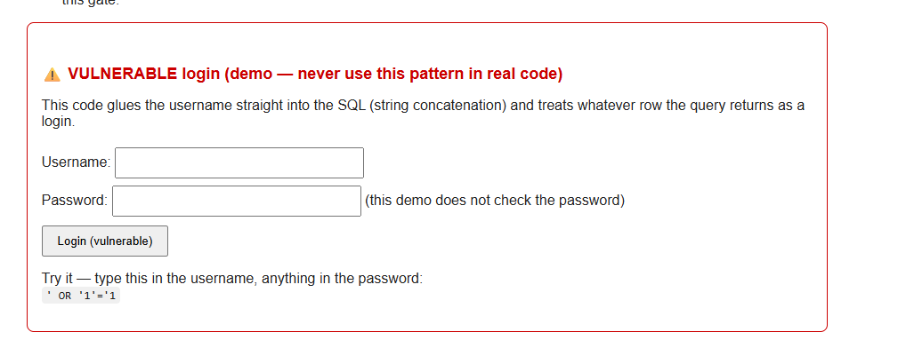
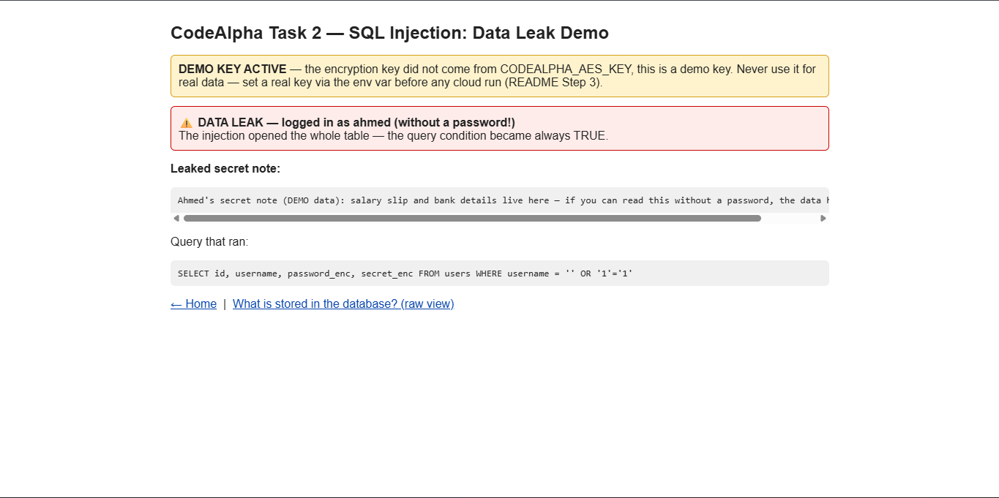
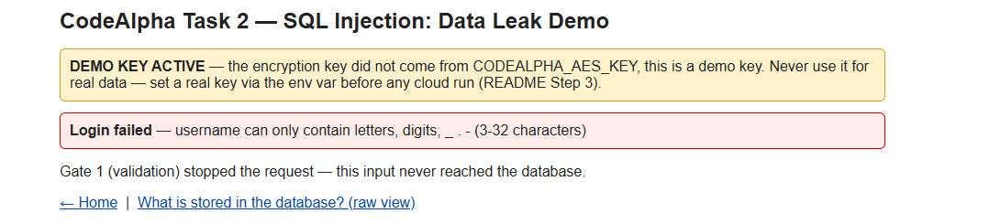
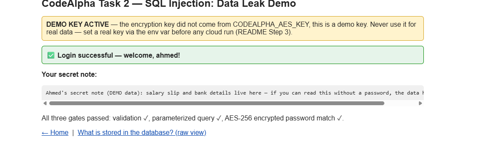
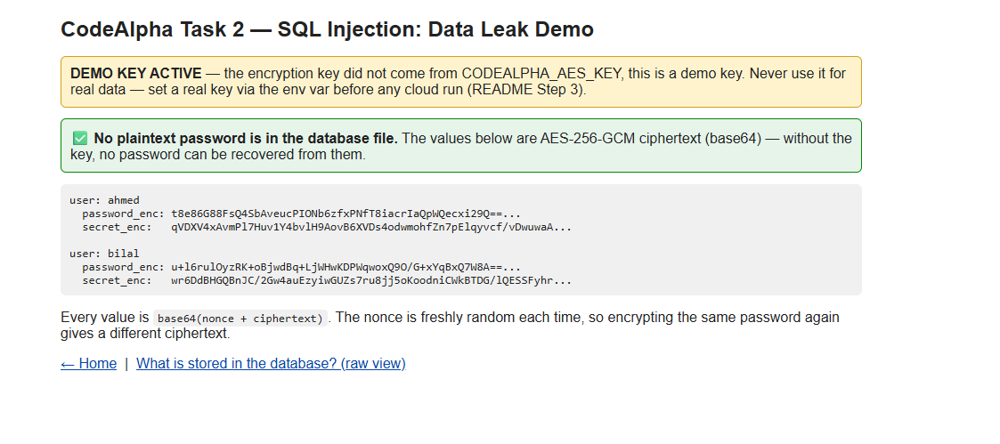

# CodeAlpha — Cloud Computing Internship, Task 2

## Detecting Data Leaks Using SQL Injection

**Track (correct name): Cloud Computing** — not "Cloud Security".
CodeAlpha has a Cyber Security track, but no Cloud Security track, so
on your CV / LinkedIn / mentor messages this internship is
**"Cloud Computing Internship"**. The security angle comes from what
you build, not the track name.

**Task (from the CodeAlpha PDF):** build a cloud system that secures
user data against SQL injection attacks; store credentials and
sensitive info with AES-256 encryption; double-layer security;
accessible over the internet without heavy system requirements.

**Stack:** Python + Flask + SQLite. Local run ke liye AWS ki zaroorat
nahi; cloud run Free Tier EC2 t2.micro par, region
**ap-southeast-2 (Sydney)** — wohi setup jo tumhare AWS Labs 01–06
ka hai. **Cost: $0** — Free Tier, instance demo ke baad terminate
kar do.

## How it works

Do login forms hain, side by side — aik jaan boojh kar kamzor, aik
secure. Dono ko aik hi injection string se azmao:

| | Vulnerable (`/login/vulnerable`) | Secure (`/login/secure`) |
|---|---|---|
| SQL kaise banta hai | String concatenation — username seedha SQL mein jur jata hai | Parameterized query — input sirf data banta hai, SQL nahi |
| `' OR '1'='1` ka natija | Query `WHERE username = '' OR '1'='1'` ban jati hai — har row match, Ahmed ke tor par login, us ka secret note leak | Validation gate par ruk jati hai; query mein bhi literal username samjhi jati hai — koi match nahi, login fail |
| Password check | Hai hi nahi (is kharab code ka hissa) | Stored password decrypt kar ke compare hota hai |
| Stored credentials | — (wahi encrypted table, lekin leak hone par bhi ciphertext hai) | AES-256-GCM encrypted |

**Double-layer security (secure wala):**
- **Layer 1 — Parameterized queries** (PDF ke "capability code
  mechanism" ka matlab yehi liya hai — prepared statements): database
  pehle SQL compile karta hai, phir input bind karta hai, is liye
  input query ko badal hi nahi sakta.
- **Layer 2 — AES-256 encryption at rest:** password aur secret note
  database mein encrypted hain (AES-GCM, 256-bit key). Agar koi row
  leak bhi ho jaye to woh ciphertext hai, password nahi.
- **Extra — Input validation:** username ka pattern pehle se tay hai
  (`A-Z a-z 0-9 _ . -`, 3–32 chars). Injection string is gate par hi
  ruk jati hai.

**Encryption key:** `CODEALPHA_AES_KEY` env var se aati hai (64 hex
chars ya base64, 32 bytes = 256-bit). Bina env var ke aik DEMO key
use hoti hai — code mein saaf likha hai ke wo demo-only hai, real
data ke liye kabhi nahi. Cloud run se pehle asli key set karo (Step 3).

**Imaandaar notes (demo vs production):**
- Production mein passwords HASH kiye jate hain (bcrypt/argon2),
  encrypt nahi. PDF ne AES-256 encryption maanga hai, is liye wohi
  demonstrate kiya hai.
- Vulnerable endpoint sirf seekhne ke liye hai — is pattern ko kabhi
  real code mein use mat karna.
- Is demo mein rate limiting / lockout nahi hai — production login
  ko wo bhi chahiye.

## Run it — one command at a time (Windows PowerShell)

**Step 1 — dependencies + app chalao (local, AWS ki zaroorat nahi):**
```powershell
pip install -r requirements.txt
python app.py
```
Phir browser mein kholo: **http://127.0.0.1:5000**

Demo users (fake data): `ahmed` / `Ahmed@123` aur `bilal` /
`Bilal@456`.

**Step 2 — injection demo (yehi Task 2 ka asal kaam hai):**

Vulnerable form mein:
- Username: `' OR '1'='1`
- Password: kuch bhi likh do
- Natija: **"DATA LEAK — logged in as ahmed"** + Ahmed ka secret
  note dikhega. Page par chali hui query bhi dikhegi — dekho ke
  `WHERE username = '' OR '1'='1'` kaise har row ko match kar gaya.

Secure form mein wohi string:
- Username: `' OR '1'='1`
- Password: kuch bhi
- Natija: **"Login failed"** — validation gate par ruk gayi.

Phir secure form mein sahi login azmao: `ahmed` / `Ahmed@123` →
**"Login successful"** + secret note. Matlab secure code sahi login
ko rokta nahi, sirf hamla rokta hai.

Phir **"Database mein kya stored hai?"** wala link kholo (`/db`) —
dekho ke passwords plaintext mein nahi hain, AES-256 ciphertext
(base64) hain. Page khud check kar ke batata hai ke database file
mein koi plaintext password nahi hai.

**Step 3 — cloud run (EC2, Free Tier t2.micro, Sydney):**

Sirf steps hain — instance tabhi launch karna jab demo ke liye
chahiye ho. Kuch bhi pehle se launch nahi hai.

1. EC2 Console (region **ap-southeast-2**) → Launch instance →
   Ubuntu 24.04, **t2.micro** (Free Tier), key pair banao ya purana
   use karo.
2. Security group: sirf 2 rules — **SSH (22)** apni IP se,
   **Custom TCP 5000** apni IP se. Baaki sab band.
3. SSH karo, phir (Ubuntu 24.04 par `pip3 install` seedha nahi
   chalta — is liye venv use karo):
```bash
sudo apt update && sudo apt install -y python3-venv git
git clone https://github.com/Talal-ah-cloud/CodeAlpha_SQLInjectionDefense.git
cd CodeAlpha_SQLInjectionDefense
python3 -m venv venv
source venv/bin/activate
pip install -r requirements.txt
```
4. Asli encryption key set karo (demo key cloud par kabhi nahi):
```bash
python3 -c "import os; print(os.urandom(32).hex())"
export CODEALPHA_AES_KEY=<upar wali key>
```
5. App chalao (venv ka python use karo, taake activation par
   depend na kare):
```bash
CODEALPHA_HOST=0.0.0.0 nohup venv/bin/python app.py &
```
6. Browser mein kholo: `http://<instance-ka-public-IP>:5000`
   — wohi demo, ab internet par.

**Step 4 — cleanup ($0 rule):**
- EC2 Console mein instance **Terminate** karo, phir security group
  aur key pair delete karo (agar naye banaye thay). Instances list
  mein 0 rehni chahiye.
- Local: dobara fresh demo chahiye ho to `users.db` delete kar do —
  agle run par dobara ban jayegi.

## Screenshots (proof of run)

1. Home page + vulnerable login form:

2. Injection on the vulnerable form — DATA LEAK:

3. Same injection on the secure form — blocked at Gate 1:

4. Correct login on the secure form — all three gates pass:

5. Database raw view — AES-256 ciphertext, no plaintext:


## GitHub (CodeAlpha ki requirement)

Repo ka naam PDF ke rule ke mutabiq: **`CodeAlpha_SQLInjectionDefense`**
(`CodeAlpha_ProjectName` format). Is folder ki files upload karo —
`app.py`, `README.md`, `requirements.txt`, `.gitignore`.
**Koi credential commit mat karna** — encryption key env var mein
hai, code mein nahi; `.db` file bhi `.gitignore` mein hai.

## Submission (PDF ke mutabiq)

1. LinkedIn par internship status share karo, **@CodeAlpha** tag karo.
2. Code GitHub repo mein daalo (upar wala naam).
3. Project ki **video explanation** LinkedIn par post karo, GitHub
   repo link ke saath.
4. Submission Form se submit karo — form tumhare **WhatsApp group**
   mein share hoga. Sirf usi form se submit karna hai.
5. Certificate ke liye **kam se kam 2 tasks** zaroori hain — 1 task
   incomplete mana jayega. (Task 1 + Task 2 = certificate complete.)

## Agla — Task 3 (plan, abhi code nahi)

- **Task 3 — Bus Pass System:** Flask booking app EC2 + DynamoDB.
  Scaling ke liye Auto Scaling + Load Balancer ka design (bina paid
  cheez chalaye).
- **Task 4 (chatbot) skip** — chatbot tum pehle se banate ho, naya
  kuch nahi seekho ge.
- **Order: 1 → 2 → 3.** Har project par aik security layer lagao
  (S3 public-access block, security groups mein sirf zaroori ports,
  IAM least-privilege) — yehi cheez Cloud Computing internship ko
  Cloud Security profile banati hai.
